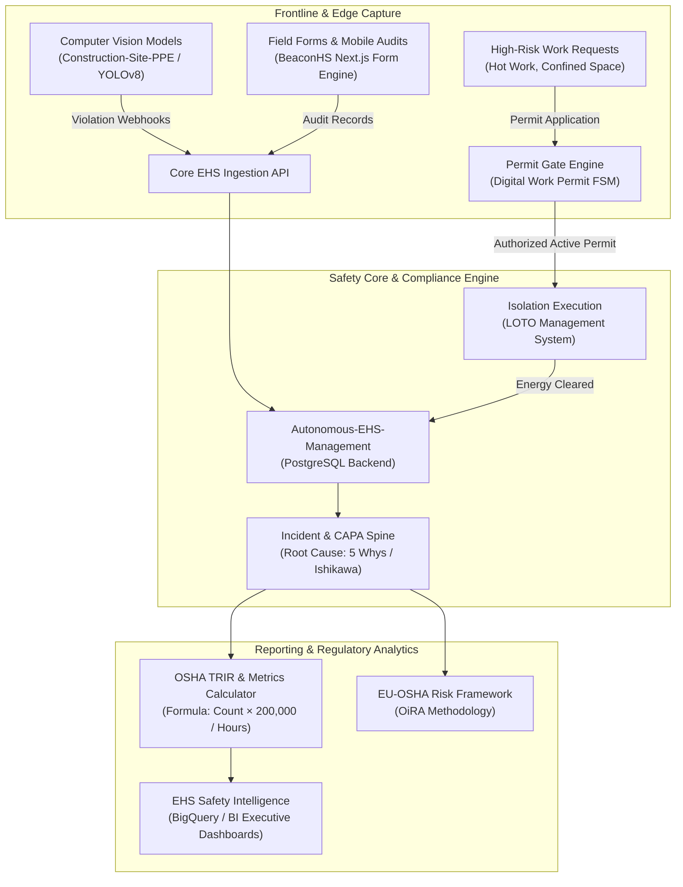

<div align="center">



<br/>
<br/>

<p align="center">
  <a href="https://github.com/ishandutta2007/Awesome-Awesome-Awesome"></a>
  <a href="https://discord.gg/jc4xtF58Ve"></a>
  <a href="https://github.com/ishandutta2007/Awesome-Workplace-Health-Safety-EHS/stargazers"></a>
  <a href="https://github.com/ishandutta2007/Awesome-Workplace-Health-Safety-EHS/network/members"></a>
  <a href="https://github.com/ishandutta2007/Awesome-Workplace-Health-Safety-EHS/blob/main/LICENSE"></a>
  <a href="http://makeapullrequest.com"></a>
  <a href="https://github.com/ishandutta2007"></a>
</p>

# 🦺 Awesome Workplace Health & Safety (EHS)

**A curated index of enterprise SaaS platforms, compliance tracking tools, incident response software, and open-source workplace safety projects.**

*Engineered for EHS Directors, Safety Engineers, Industrial Hygienists, Operations Managers, and Compliance Officers.*

[](#)
[](#-how-to-contribute)
[](#)
[](#)

</div>

---

## 📌 Quick Summary & SEO Scope

**Workplace Health & Safety (EHS / HSE / OHS)** software platforms empower organizations to identify workplace hazards, systematically log incident records, enforce Corrective and Preventive Actions (**CAPA**), manage electronic Permit-to-Work (**PTW**) workflows, calculate Total Recordable Incident Rates (**TRIR**), perform Lockout/Tagout (**LOTO**) safety audits, and satisfy regulatory mandates across **OSHA (29 CFR 1904 / 1910)**, **ISO 45001**, and **EU-OSHA**.

This repository catalogs:
- 🏢 **Enterprise SaaS Platforms**: Commercial category leaders evaluated by market valuation, transparent starting prices, and free trial access limits.
- 💻 **Open-Source GitHub Projects**: Community-developed, self-hosted EHS suites, state-machine permit governors, LOTO systems, and computer vision PPE detection models ranked by GitHub_Stars.

---

## 📑 Table of Contents

- [📊 Sector Overview & Market Dynamics](#-sector-overview--market-dynamics)
- [🏢 SaaS & Commercial EHS Platforms](#-saas--commercial-ehs-platforms)
  - [SaaS Solutions Comparison Table](#saas-solutions-comparison-table)
- [💻 Open-Source GitHub Projects](#-open-source-github-projects)
  - [Ranked Open-Source Safety Projects](#ranked-open-source-safety-projects)
  - [Architectural Patterns for Self-Hosted EHS Stacks](#architectural-patterns-for-self-hosted-ehs-stacks)
- [🔍 Domain Terminology & Standards](#-domain-terminology--standards)
- [🤝 How to Contribute](#-how-to-contribute)
- [💖 Support & Community](#-support--community)
- [📈 Star History](#-star-history)
- [⚠️ Disclaimer](#️-disclaimer)

---

## 📊 Sector Overview & Market Dynamics

- **Market Size & Growth:** The global Environmental Health and Safety (EHS) and workplace safety software market is estimated at **$1.9B to $2.1B** (Verdantix, 2023–2024) and is projected to expand to **$4.5B by 2029**, progressing at a compound annual growth rate (**CAGR of 14.6%**). Sustained market expansion is driven by tightening statutory regulations (OSHA electronic record submission, EU Corporate Sustainability Due Diligence, ISO 45001 audits), enterprise convergence of EHS with ESG disclosures, and rapid frontline mobile digitization.
- **Market Dynamics & Fragmentation:** The sector demonstrates a **moderately fragmented** ecosystem rather than a winner-take-all monopoly. While established enterprise conglomerates (Wolters Kluwer's Enablon, Fortive's Intelex, Workday) and private-equity-backed suites (Cority, VelocityEHS, AMCS Quentic) dominate Tier-1 multinational accounts, significant geographic divergence in labor regulations, chemical inventories, and specialized operational needs (construction vs. petrochemical vs. discrete manufacturing) preserve strong market share for agile mid-market providers and mobile-first frontline inspection tools (e.g., SafetyCulture).

---

## 🏢 SaaS & Commercial EHS Platforms

The table below outlines the leading commercial platforms across Workplace Health & Safety, sorted in **descending order by company scale** (market capitalization or private institutional valuation).

### SaaS Solutions Comparison Table

| 🏢 Platform | 💼 Company Scale (Valuation / Revenue) | 🎯 Core Capabilities & Regulatory Scope | 💵 Starting Pricing Tier | 🎁 Free Tier / Trial Limits |
| :--- | :--- | :--- | :--- | :--- |
| **[Workday Health and Safety](https://www.workday.com/)** | **~$52.4B USD** Market Cap (NASDAQ: WDAY)<br/>*FY26 Rev: $9.55B* | Native enterprise HCM module unifying worker injury reporting, OSHA 300/300A/301 logs, hazard identification, and workforce return-to-work programs. | **~$35 – $130 / employee / year** (~$3–$11/mo per worker headcount); typical entry contracts start at **$30,000/yr** (500–1,000 seat threshold). | **No free forever plan.** Guided 30-day proof-of-concept (POC) sandbox environment accessible via sales consultation for qualifying enterprises. |
| **[Enablon](https://www.enablon.com/)** *(Wolters Kluwer)* | **~$21.0B USD** (€19.5B) Market Cap (AMS: WKL)<br/>*FY25 Rev: €6.13B* | Tier-1 enterprise EHS, Operational Risk Management (ORM), Control of Work, barrier management, and ESG sustainability accounting for industrial conglomerates. | Starts at **~$50,000 / year** baseline configuration (~$100+/user/month for mid-tier deployments plus mandatory onboarding services). | **No free forever plan.** 0-day self-service trial; offers scheduled live architect-led platform demonstrations and scoping consultations. |
| **[Intelex](https://www.intelex.com/)** *(Fortive Corporation)* | **~$17.8B USD** Market Cap (NYSE: FTV)<br/>*Fortive Rev: $4.2B* | Industrial EHSQ platform covering incident investigation, occupational clinic records, job hazard analyses (JHA), permits, and contractor compliance. | Safety Essentials tier starts at **$44 – $49 / user / month** (billed annually with a mandatory **25-user minimum**, starting at **$13,200/yr**). | **No free forever plan.** 0-day self-service trial; provides guided interactive on-demand product tours and sales-assisted sandbox test drives. |
| **[Quentic](https://www.quentic.com/)** *(AMCS Group / EQT)* | **~$2.2B USD** (€2.0B) Valuation by EQT<br/>*AMCS Rev: €180M+* | Comprehensive European EHSQ platform specializing in hazardous chemical registration (REACH/CLP), incident logging, environmental indicators, and ISO 45001 audits. | Modular packages start at **~€10,000 – €15,000 / year** (~€830–€1,250/mo) for baseline incident and risk assessment modules. | **No free forever plan.** 0-day self-service trial; provides scheduled live custom demonstrations and module preview access upon request. |
| **[Cority](https://www.cority.com/)** *(Thoma Bravo)* | **~$2.0B USD** Valuation<br/>*Estimated Rev: ~$120M+* | Integrated CorityOne cloud spanning occupational health clinic charting, industrial hygiene air/noise monitoring, ergonomic assessments, and incident CAPA. | Baseline mid-market deployment starts at **~$40,000 – $50,000 / year** depending on selected cloud modules and administrative seat licenses. | **No free forever plan.** 0-day self-service trial; provides tailored enterprise workflow demonstrations and solution design evaluations. |
| **[SafetyCulture](https://safetyculture.com/)** *(iAuditor)* | **~$1.7B USD** (A$2.5B) Valuation<br/>*FY25 Rev: A$197M* | Mobile-first safety inspection checklist engine, near-miss hazard reporting, frontline toolbox talks, asset maintenance checks, and automated CAPA ticketing. | **$24 / user / month** (billed annually) or **$29 / user / month** (billed monthly) for the Premium plan; custom pricing for Enterprise. | **Free Forever Plan** available for up to **10 team members**, **5 active templates**, unlimited inspections, and **3-year data history**. Premium tier includes a **30-day free trial**. |
| **[VelocityEHS](https://www.velocityehs.com/)** *(CVC / Partners Group)* | **~$1.5B USD** Valuation<br/>*Estimated ARR: ~$100M* | VelocityEHS Accelerate platform featuring cloud Safety Data Sheet (SDS) authoring/management, AI-driven computer vision ergonomics, and incident RCA. | Single-module starter suites (e.g., MSDS/Chemical inventory) start at **~$100 – $200 / month** (~$5,000/yr entry threshold including setup). | **No free forever plan.** 0-day self-service platform trial; offers limited free public lookups on SDS databases and vendor-guided product demos. |
| **[Origami Risk](https://www.origamirisk.com/)** *(Spectrum Equity)* | **~$800M – $1.0B USD** Valuation<br/>*Annual Rev: ~$189M* | Unified multi-tenant SaaS fusing EHS incident investigation, worker compensation claim handling, safety audit forms, and Total Cost of Risk (TCOR) analytics. | Standard mid-market incident and audit baseline starts at **~$25,000 – $40,000 / year** based on modules and corporate claim volumes. | **No free forever plan.** 0-day self-service trial; offers custom sales-led demonstrations and online risk-maturity assessment tools. |
| **[EcoOnline](https://www.ecoonline.com/)** *(Apax Partners)* | **~$380M USD** (NOK 3.77B buyout)<br/>*Annual ARR: ~$65M* | Chemical safety management, Safety Observation cards, lone-worker SOS tracking, digital safety checklists, and EU environmental compliance reporting. | Incident and chemical tracking modules start at **~$300 – $500 / month** (~$3,600–$6,000/yr) with **unlimited frontline reporting users** included. | **No free forever plan.** 0-day self-service trial; offers custom 14-day evaluation access upon sales qualification for hazardous chemical modules. |
| **[Benchmark ESG](https://www.benchmarkgensuite.com/)** *(Gensuite)* | **~$350M USD** Valuation<br/>*Annual Rev: ~$68.6M* | Configurable suite with 65+ specialized applications spanning OSHA injury logs, Lockout/Tagout procedures, behavioral safety audits, and industrial hygiene. | Standard single-facility incident and compliance starter packs start at **~$12,000 – $20,000 / year** with annual subscription licensing. | **No free forever plan.** 0-day self-service trial; provides personalized live video demonstrations and technical scoping sessions. |

---

## 💻 Open-Source GitHub Projects

Open-source tooling in workplace safety spans from full-featured web-based EHS platforms to specialized computer vision models automating Personal Protective Equipment (**PPE**) detection on shop floors and construction sites.

### Ranked Open-Source Safety Projects

The projects below are **strictly ranked in descending order by GitHub stargazers count** :star:.

1. **[Construction-Site-Safety-PPE-Detection](https://github.com/snehilsanyal/Construction-Site-Safety-PPE-Detection)** [](https://github.com/snehilsanyal/Construction-Site-Safety-PPE-Detection/stargazers)  
   *Real-time custom YOLOv8 deep learning pipeline trained specifically for construction site worker safety gear detection.* Accurately segments and flags missing hard hats, safety vests, protective gloves, and safety goggles from surveillance feeds to enforce site safety protocols.

2. **[PPE-Detection-YOLO-Deep_SORT](https://github.com/AnshulSood11/PPE-Detection-YOLO-Deep_SORT)** [](https://github.com/AnshulSood11/PPE-Detection-YOLO-Deep_SORT/stargazers)  
   *Industrial worker tracking and PPE compliance monitor.* Combines YOLO object detection with DeepSORT multi-target tracking to monitor individual worker trajectories through hazardous factory zones, detecting PPE non-compliance in real-time.

3. **[PPE_detection](https://github.com/ZijianWang-ZW/PPE_detection)** [](https://github.com/ZijianWang-ZW/PPE_detection/stargazers)  
   *High-quality industrial safety dataset and YOLO-based PPE recognition system.* Focuses on industrial edge deployment for automated gate checks and workshop entry safety verification.

4. **[videopipe-fastapi](https://github.com/xuansan/videopipe-fastapi)** [](https://github.com/xuansan/videopipe-fastapi/stargazers)  
   *AI video intelligent safety management platform (FastAPI backend).* General-purpose full-stack computer vision system providing perimeter zone intrusion alarms, smoke/fire alerts, and shop-floor safety violation notifications.

5. **[PPE_detection_using_YOLOV8](https://github.com/Ismailjm/PPE_detection_using_YOLOV8)** [](https://github.com/Ismailjm/PPE_detection_using_YOLOV8/stargazers)  
   *Automated real-time safety compliance detector.* Uses YOLOv8 to classify worker compliance against safety regulations across live camera inputs, logging timestamped violations for safety managers.

6. **[ppe-safety-detection-ai](https://github.com/prodbykosta/ppe-safety-detection-ai)** [](https://github.com/prodbykosta/ppe-safety-detection-ai/stargazers)  
   *End-to-end computer vision system for workplace safety monitoring.* Detects personnel, verifies helmet and high-visibility vest compliance, maintains worker identity tracking, and generates annotated MP4 audit videos.

7. **[WorkplaceSafety](https://github.com/balakreshnan/WorkplaceSafety)** [](https://github.com/balakreshnan/WorkplaceSafety/stargazers)  
   *Azure Custom Vision workplace safety detection architecture.* Demonstrates hybrid cloud and edge AI inference for monitoring shop-floor protective equipment and automated safety alerting.

8. **[BeaconHS](https://github.com/braedonsaunders/beaconhs)** [](https://github.com/braedonsaunders/beaconhs/stargazers)  
   *Modern open-source Health, Safety & Environment (HSE) platform tailored for industrial construction.* Built with Next.js, TypeScript, and PostgreSQL. Features a visual drag-and-drop form builder for Job Safety Analyses (JSA), incident logging, multi-tenant row-level security (RLS), and automated contractor compliance tracking.

9. **[Autonomous-EHS-Management](https://github.com/SafetyMP/Autonomous-EHS-Management)** [](https://github.com/SafetyMP/Autonomous-EHS-Management/stargazers)  
   *Self-hosted open-source EHS incident-to-verified-CAPA console (Apache 2.0).* Operates on PostgreSQL with a closed-loop spine: **incident &rarr; linked CAPA &rarr; verified closure**. Computes OSHA Total Recordable Incident Rate (`TRIR = (recordables × 200,000) / hours worked`) with safeguards for incomplete month grids; includes demo fixtures for Root Cause Analysis (5 Whys / Ishikawa diagrams) and risk registers.

10. **[osha.oira](https://github.com/euphorie/osha.oira)** [](https://github.com/euphorie/osha.oira/stargazers)  
    *EU-OSHA's Online Interactive Risk Assessment tool.* Built on the open-source Euphorie web framework (Python/Plone); equips small and medium enterprises with sector-specific occupational risk questionnaires and automated action plan generators aligned with European Union workplace directives.

11. **[ehs-safety-intelligence](https://github.com/nawwarah-analyst/ehs-safety-intelligence)** [](https://github.com/nawwarah-analyst/ehs-safety-intelligence/stargazers)  
    *Enterprise EHS business intelligence and data analytics platform.* Transforms raw incident records, audit logs, and employee safety training completions into actionable operational risk dashboards using Google BigQuery and Power BI.

12. **[ehsbase](https://github.com/coreaxiskkdutt/ehsbase)** [](https://github.com/coreaxiskkdutt/ehsbase/stargazers)  
    *Integrated Environment, Health & Safety management system.* Features modular components for workplace risk assessment matrices, compliance document management, incident tracking, and digital permit authorization.

13. **[Digital Work Permit System](https://github.com/gauravdev148/Digital_Work_Permit_System)** [](https://github.com/gauravdev148/Digital_Work_Permit_System/stargazers)  
    *State-machine-based Permit-to-Work (PTW) system (Python/Flask).* Strictly enforces ISO 45001 safety gates via finite state machines. Prohibits workflow bypasses by requiring verified transitions through `SAFETY_CHECK` and `APPROVAL` before permits enter `ACTIVE` state.

14. **[loto_management-system](https://github.com/Mjeed42/loto_management-system)** [](https://github.com/Mjeed42/loto_management-system/stargazers)  
    *Full-stack Lockout/Tagout (LOTO) energy isolation platform.* Implemented in React, Node.js, and MongoDB with Docker support. Enforces zero-energy state verification, lock/tag inventory assignments, and bilingual (EN/AR) role-based sign-offs.

15. **[AWS-LOTO-Board](https://github.com/Davide-Rossetti-PhD/AWS-LOTO-Board)** [](https://github.com/Davide-Rossetti-PhD/AWS-LOTO-Board/stargazers)  
    *Cloud-native serverless Lockout/Tagout digitization board.* Deploys on AWS Lambda, DynamoDB, and API Gateway at ultra-low operating cost (~$0.35/month); supports mobile QR/barcode scanning and real-time Slack incident notifications.

---

### Architectural Patterns for Self-Hosted EHS Stacks

For organizations designing a self-hosted, sovereign EHS architecture:



---

## 🔍 Domain Terminology & Standards

| Term | Full Name | Regulatory Significance |
| :--- | :--- | :--- |
| **EHS / HSE** | Environment, Health & Safety / Health, Safety & Environment | Holistic operational discipline managing safety hazards, worker well-being, environmental discharges, and legal compliance. |
| **OSHA** | Occupational Safety and Health Administration (US Dept of Labor) | US federal agency setting and enforcing workplace safety standards (e.g., 29 CFR 1904 injury recording, 1910 general industry). |
| **TRIR** | Total Recordable Incident Rate | Key safety performance metric: `(Number of OSHA-recordable injuries × 200,000) / Total hours worked`. Benchmarks safety performance across industries. |
| **CAPA** | Corrective and Preventive Actions | Structured post-incident workflow ensuring root-cause mitigation and tracking remedial actions to validated closure. |
| **PTW** | Permit-to-Work | Formal legal and operational authorization required before commencing high-risk activities (hot work, confined space entry, working at height, live electrical). |
| **LOTO** | Lockout / Tagout (29 CFR 1910.147) | Strict physical and administrative procedures safeguarding employees from hazardous energy re-energization during maintenance. |
| **JSA / JHA** | Job Safety Analysis / Job Hazard Analysis | Systematic task-by-task risk assessment method to identify potential hazards and establish controls before work begins. |
| **ISO 45001** | Occupational Health & Safety Management Standard | Globally recognized international standard specifying requirements for enterprise OH&S management systems. |

---

## 🤝 How to Contribute

Contributions to expand and refine this ecosystem are warmly welcome!

1. 🍴 **Fork the repository** on GitHub.
2. 🌿 **Create a feature branch**:
   ```bash
   git checkout -b feature/add-ehs-tool
   ```
3. 📝 **Add or update an entry** in `README.md`:
   - Keep descriptions factual, unbiased, and technically precise.
   - For SaaS products: include verified starting prices, exact free trial/tier limits, and company scale metrics.
   - For open-source tools: include valid GitHub Stars_Badges (`style=social&color=white`) linking to the stargazers page.
4. 🧪 **Check link validity** and ensure clean Markdown formatting.
5. 🚀 **Commit and open a Pull Request** with a concise description of your additions.

Explore more curated developer lists at **[Awesome-Awesome-Awesome](https://github.com/ishandutta2007/Awesome-Awesome-Awesome)**.

---

## 💖 Support & Community

If you find this curated directory useful for your organization, safety team, or research:

- ⭐ **Star this repository** to improve discoverability for other safety professionals.
- 🍴 **Fork and share** with your EHS network and engineering colleagues.
- 💬 **Join our discussions** on our [Discord Community](https://discord.gg/jc4xtF58Ve).
- ☕ **Sponsor & Buy Me a Coffee:** Support continuous maintenance, open-source curations, and ecosystem research via the [GitHub Sponsor Dashboard](https://github.com/sponsors/ishandutta2007).

<div align="center">

<a href="https://github.com/sponsors/ishandutta2007">
  
</a>

</div>

---

## 📈 Star History

[](https://star-history.dera.page/#ishandutta2007/Awesome-Workplace-Health-Safety-EHS&type=date&legend=top-left)

---

## ⚠️ Disclaimer

- This repository is a **community-curated informational directory** and does not constitute formal legal, occupational health, or regulatory safety advice.
- EHS platforms handling employee personal health records, accident reports, and biometric information are governed by strict legal frameworks (e.g., OSHA reporting rules, HIPAA for health data in the US, GDPR in the European Union).
- Open-source implementations must be independently reviewed and certified to ensure strict alignment with your local regulatory jurisdiction, trade union requirements, and site safety management systems.
- Commercial trademarks and product names belong to their respective corporate entities.

---

<div align="center">
  <sub>Crafted with care for safety officers, industrial hygienists, and operations leaders worldwide.</sub>
</div>
